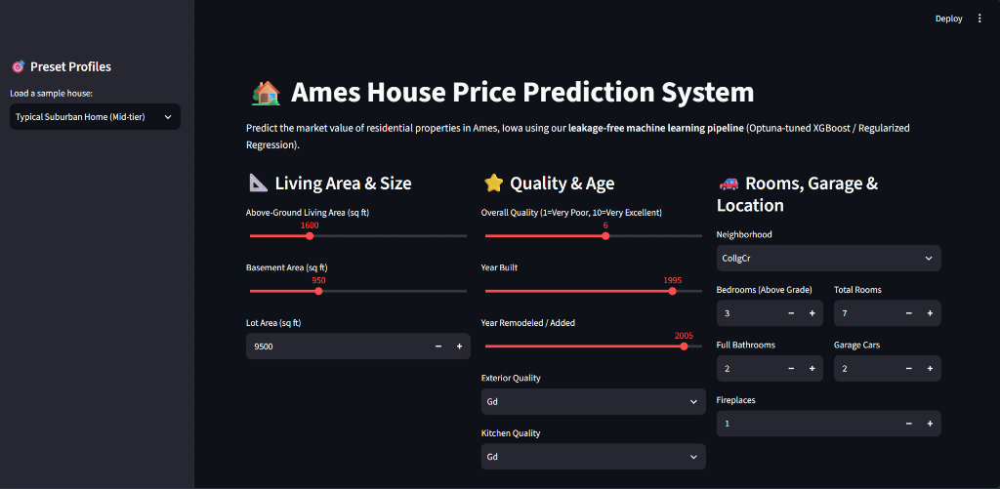
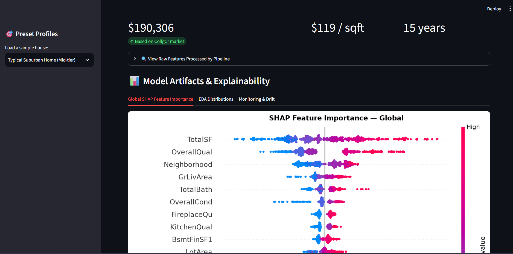
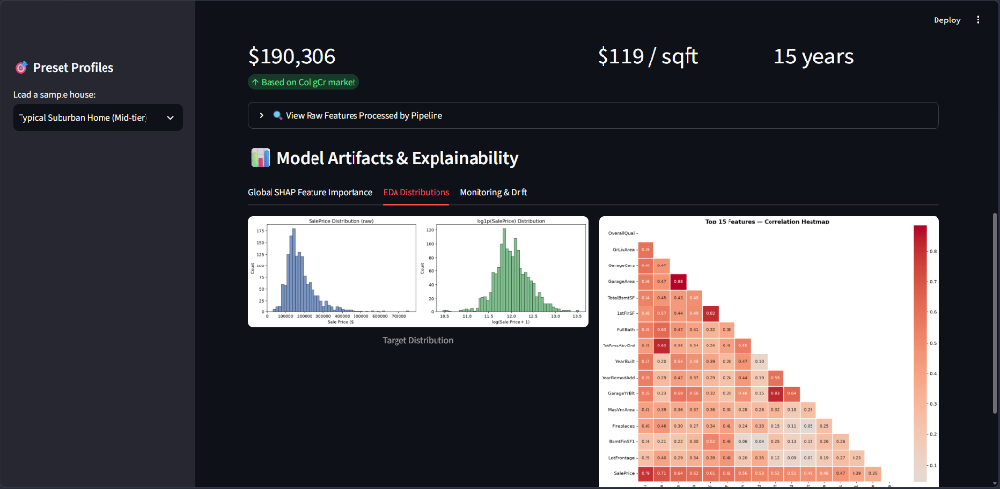
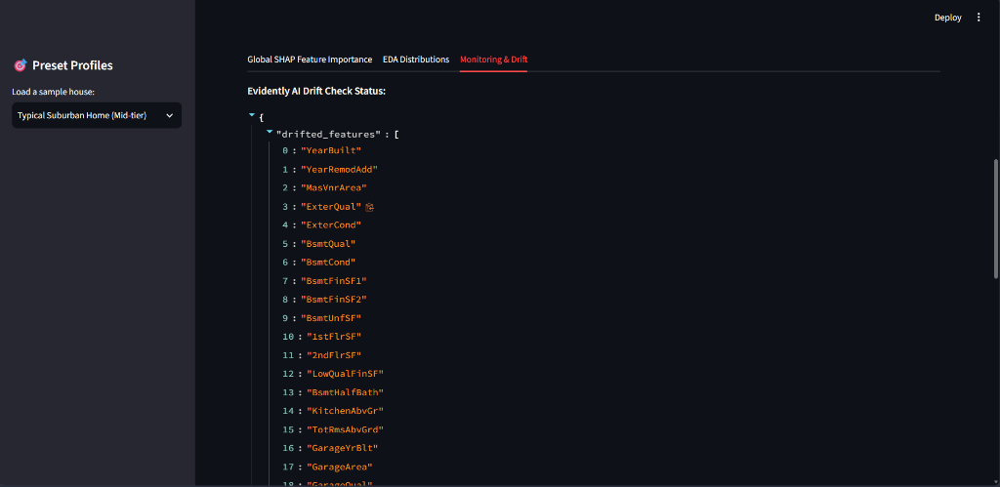

# House Price Prediction — End-to-End ML System

> **Status: Complete** | Ames Housing Dataset | XGBoost/LightGBM + SHAP + FastAPI + Docker + Evidently AI

---

## Overview

A production-style ML system that predicts house sale prices from property features. This is **not** a notebook-only project — it includes:

- ✅ Leakage-free feature engineering pipeline
- ✅ 5-fold cross-validation with MLflow experiment tracking
- ✅ Hyperparameter tuning via Optuna (Bayesian search)
- ✅ SHAP explainability (global + per-prediction)
- ✅ FastAPI deployment with Docker
- ✅ Interactive Streamlit web application (`app.py`)
- ✅ Evidently AI data drift monitoring

**Target performance**: CV RMSE ~0.11–0.13 (log scale), competitive with Kaggle public leaderboard.

---

## 📸 Application Interface & Visualizations

### 1. Interactive Property Valuation UI
Adjust property features (living area, overall quality, year built, garage capacity, neighborhood) with live valuation feedback.


### 2. Live Prediction & SHAP Feature Explanations
Real-time house price estimation alongside global SHAP impact explaining which features drove the valuation.


### 3. Exploratory Data Distributions & Correlation Analysis
Inspect the raw vs. log-transformed target price distributions and top correlated feature pairs.


### 4. Evidently AI Data Drift Monitoring
Continuous production data monitoring tracking distribution shifts and automatic retrain triggers.


---

## Project Structure

```
house-price-ml/
├── app.py                  # Interactive Streamlit Web Application
├── data/
│   ├── raw/                # train.csv, test.csv
│   └── processed/          # feature_pipeline.pkl, shap_summary.png, eda/
├── docs/
│   └── screenshots/        # UI and analysis screenshots
├── src/
│   ├── config.py           # All paths + feature lists (single source of truth)
│   ├── data_prep.py        # load_data(), remove_outliers(), get_cv_folds()
│   ├── feature_eng.py      # FeatureEngineer (fit/transform, leakage-free)
│   ├── eda.py              # EDA charts + summary report
│   ├── train.py            # CV training, MLflow logging, model comparison
│   ├── tune.py             # Optuna hyperparameter search
│   ├── evaluate.py         # RMSE, MAE, residual analysis
│   ├── explain.py          # SHAP global + local explanations
│   └── predict.py          # Inference utility (cached model load)
├── api/
│   ├── main.py             # FastAPI app (/predict, /health)
│   ├── schema.py           # Pydantic input/output models
│   └── model_loader.py     # Singleton model + pipeline loader
├── monitoring/
│   └── drift_report.py     # Evidently DataDrift report
├── models/                 # best_model.pkl (post-training)
├── tests/
│   ├── test_feature_eng.py # No-NaN + leakage-free unit tests
│   ├── test_predict.py     # Predict sanity tests
│   └── test_api.py         # FastAPI endpoint integration tests
├── Dockerfile
└── requirements.txt
```

---

## Setup

### 1. Environment

```bash
# Using the existing venv
.\venv\Scripts\activate          # Windows
# or
source venv/bin/activate          # Linux/Mac

pip install -r requirements.txt
```

### 2. Download Dataset

Download from [Kaggle](https://www.kaggle.com/c/house-prices-advanced-regression-techniques/data) and place:
```
data/raw/train.csv
data/raw/test.csv
```

Or via Kaggle API:
```bash
kaggle competitions download -c house-prices-advanced-regression-techniques -p data/raw/
cd data/raw && unzip house-prices-advanced-regression-techniques.zip
```

---

## Running the Pipeline

### Phase 1 — EDA
```bash
python -m src.eda
# Outputs: data/processed/eda/*.png
```

### Phase 2-3 — Training (all models + CV)
```bash
python -m src.train
# Logs all runs to MLflow, saves best_model.pkl + feature_pipeline.pkl
```

### Phase 4 — Hyperparameter Tuning
```bash
python -m src.tune --model lightgbm --trials 100
# Overwrites best_model.pkl with tuned model
```

### Phase 5 — SHAP Explainability
```bash
python -m src.explain
# Saves data/processed/shap_summary.png, logs to MLflow
```

### Phase 6 — API & Interactive Web UI
```bash
# FastAPI Backend
uvicorn api.main:app --reload --port 8000
# Swagger Docs: http://localhost:8000/docs

# Interactive Streamlit UI
streamlit run app.py
# Web UI: http://localhost:8501
```

### Phase 7 — Drift Monitoring
```bash
python -m monitoring.drift_report
# Outputs: monitoring/drift_report.html + drift_summary.json
```

---

## MLflow Tracking

```bash
mlflow ui --port 5000
# Navigate to http://localhost:5000
```

All training runs, CV metrics, and model artifacts are tracked under the `house_price_prediction` experiment.

---

## Docker

```bash
# Build
docker build -t house-price-api .

# Run
docker run -p 8000:8000 house-price-api

# Test
curl -X POST http://localhost:8000/predict \
  -H "Content-Type: application/json" \
  -d '{"OverallQual": 7, "GrLivArea": 1710, "Neighborhood": "CollgCr", "YearBuilt": 2003}'
```

---

## API Reference

### `POST /predict`
Predict sale price for a house.

**Request** (all fields optional with defaults):
```json
{
  "OverallQual": 7,
  "GrLivArea": 1710,
  "Neighborhood": "CollgCr",
  "YearBuilt": 2003,
  "TotalBsmtSF": 856,
  "GarageCars": 2
}
```

**Response**:
```json
{
  "predicted_price": 183500.00,
  "currency": "USD",
  "model_version": "1.0"
}
```

### `GET /health`
```json
{"status": "ok", "model_loaded": true, "pipeline_loaded": true}
```

---

## Tests

```bash
# Feature engineering unit tests (no model required)
python -m pytest tests/test_feature_eng.py -v

# Full test suite (requires trained model)
python -m pytest tests/ -v
```

---

## Feature Engineering

Key engineering decisions:

| Feature | Strategy |
|---|---|
| `PoolQC`, `Fence`, `Alley`, etc. | NaN → "None" (feature is absent, not missing) |
| `LotFrontage` | Imputed by Neighborhood median (captures local norms) |
| `TotalSF` | `TotalBsmtSF + 1stFlrSF + 2ndFlrSF` |
| `HouseAge` | `YrSold - YearBuilt` |
| `TotalBath` | `FullBath + 0.5*HalfBath + BsmtFullBath + 0.5*BsmtHalfBath` |
| Quality cols | Ordinal: `None=0, Po=1, Fa=2, TA=3, Gd=4, Ex=5` |
| `Neighborhood` | Target encoding (fit inside CV fold — no leakage) |
| Skewed numerics | `log1p` transform when `|skew| > 0.75` |

---

## Resume Line

> "Built end-to-end house price prediction system (Ames Housing) — leakage-free feature engineering pipeline, XGBoost/LightGBM with Optuna tuning, MLflow experiment tracking, SHAP explainability, FastAPI+Docker REST deployment, and Evidently-based data drift monitoring."

---

## Author
Vedansh — [GitHub](https://github.com) | [LinkedIn](https://linkedin.com)
